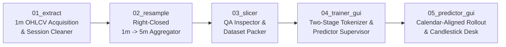

# KLine Kronos Suite (`v1.0.1`)

[](https://www.bestpractices.dev/projects/16679)
[](https://github.com/Ziqi/KLine-Kronos-Suite/actions/workflows/ci.yml)
[](https://github.com/Ziqi/KLine-Kronos-Suite/actions/workflows/codeql.yml)
[](https://scorecard.dev/viewer/?uri=github.com/Ziqi/KLine-Kronos-Suite)
[](https://github.com/Ziqi/KLine-Kronos-Suite/attestations)
[](./REUSE.toml)
[](./LICENSE)
[](https://www.python.org/)

> **English** | **[简体中文 (`README.zh-CN.md`)](./README.zh-CN.md)**

**Deterministic intraday OHLCV cleaning, session-aligned `1m -> 5m` resampling, QA auditing, two-stage fine-tuning supervision, and trading-calendar-aware inference workstation for financial time-series foundation models ([Kronos](https://github.com/shiyu-coder/Kronos)).**

---

## Why KLine Kronos Suite?

Feeding high-frequency equity bars into financial foundation models such as **Kronos** often breaks silently due to messy market microstructure details:
- **Call-auction & lunch-break artifacts** (`13:00:00` boundary ticks, `15:01–15:31` post-close ticks, or missing `15:00:00` closing bars);
- **Interval-label leakage** when resampling 1-minute bars to 5-minute bars without strict `closed='right', label='right'` alignment (`09:31..09:35 -> 09:35`);
- **Silent NaNs or non-monotonic timestamps** corrupting sliding-window Tokenizer/Predictor batches;
- **Calendar drift during multi-step rollouts** (naively adding `+5 minutes` across the `11:30–13:00` lunch break, overnight close, or weekends).

**KLine Kronos Suite** solves these end-to-end with **two complementary interfaces**:
1. **Zero-Dependency Deterministic Core & CLI (`kline_kronos/`)** — Pure Python 3.10+ standard library engine for instant headless CSV cleaning, `1m -> 5m` resampling, QA auditing, SHA-256 dataset manifests, and z-score window scaling (`>90%` statement coverage, zero `pip install` needed).
2. **Five-Stage Desktop Workstation (`01_extract/` – `05_predictor_gui/`)** — Modular `ttkbootstrap` GUI apps + PyTorch process supervisors for interactive data operations, fine-tuning monitoring, and candlestick rollout inspection.



---

## 30-Second Zero-Dependency CLI Quickstart

Run the full cleaning, `1m -> 5m` resampling, QA audit, and SHA-256 manifest pipeline immediately on Python 3.10+ using the bundled synthetic fixture (`examples/sample_1m_ohlcv.csv`):

```bash
git clone https://github.com/Ziqi/KLine-Kronos-Suite.git
cd KLine-Kronos-Suite

# 1. Clean raw 1-minute bars & ensure 15:00 session close bar
python3 -m kline_kronos clean ./examples/sample_1m_ohlcv.csv --output /tmp/sample_1m_clean.csv

# 2. Resample 1m -> 5m (closed='right', label='right')
python3 -m kline_kronos resample /tmp/sample_1m_clean.csv --out-dir /tmp/out_5m

# 3. Audit OHLCVA bounds & timestamp monotonicity
python3 -m kline_kronos audit /tmp/out_5m/sample_5m_clean.csv --min-rows 2

# 4. Emit deterministic SHA-256 dataset manifest
python3 -m kline_kronos manifest /tmp/out_5m --output /tmp/dataset_manifest.json --min-rows 2
```

---

## Five-Stage Workstation Architecture

| Module | Role | Entrypoints | Highlights |
| :--- | :--- | :--- | :--- |
| **[`kline_kronos/`](./kline_kronos/)** | **Deterministic Core & CLI** | `python3 -m kline_kronos` | Pure Python 3.10+ stdlib engine: `clean`, `resample`, `audit`, `manifest`, z-score window scaling, and A-share session calendar stepper. |
| **[`01_extract/`](./01_extract/)** | **1. 1m Collector & Cleaner** | `gui_fetch_kline.py`<br/>`miana_1m_clean_save.py`<br/>`resample_1m_to_5m.py` | Multi-threaded incremental 1m bar retrieval (`MIANA_TOKEN`), auction-noise filtering, and `15:00` bar synthesis. |
| **[`02_resample/`](./02_resample/)** | **2. `1m -> 5m` Aggregator** | `gui_resample_5m.py` | Right-closed 5-minute OHLCVA aggregation (`pandas` 2.x & 3.x `'5min'` compatible) with date-range filtering. |
| **[`03_slicer/`](./03_slicer/)** | **3. QA & Dataset Packer** | `gui_slicer.py` | Batch NaN / missing-column / length audit and Kronos `.pkl` dictionary export. |
| **[`04_trainer_gui/`](./04_trainer_gui/)** | **4. Fine-Tuning Console** | `gui_trainer.py` | Isolated `venv` process supervisor for Kronos Tokenizer & Predictor fine-tuning (`KRONOS_HOME`), live loss stream, and safe process termination. |
| **[`05_predictor_gui/`](./05_predictor_gui/)** | **5. Inference & Chart Desk** | `gui_predictor.py`<br/>`run_predictor_inference.py` | Cross-sectional z-score scaling (`clip[-5, 5]`), session-aware timestamp stepping, inverse scaling, and candlestick trajectory plotting. |

---

## Desktop Workstation Installation (Optional)

To launch the `ttkbootstrap` GUI workstations and PyTorch inference scripts:

```bash
python3 -m venv .venv
source .venv/bin/activate
pip install -r requirements.txt
pip install -e .

# Launch any stage workstation:
python3 ./02_resample/gui_resample_5m.py
```

---

## Testing, Supply-Chain Security & Provenance

- **Automated Coverage & Static Security Gate:** `python3 ./tests/test_pipeline_core.py --min-coverage 85` verifies end-to-end CLI/core behavior, trading-calendar edge cases, `>=85%` statement coverage, and AST invariants (zero `os.system`, zero bare `except:`).
- **Cryptographic Provenance:** Every release publishes Sigstore-backed **SLSA Build Level 3** provenance and **SPDX-2.3** SBOM attestations verifiable via [`/attestations`](https://github.com/Ziqi/KLine-Kronos-Suite/attestations) or `gh attestation verify`.
- **Security Policy:** See [`SECURITY.md`](./SECURITY.md) for private vulnerability reporting and `.pkl` checkpoint trust-boundary guidelines.

## Acknowledgements & License

Built for seamless integration with the **Kronos** financial foundation model ecosystem ([`shiyu-coder/Kronos`](https://github.com/shiyu-coder/Kronos)). Released under the [MIT License](./LICENSE).
