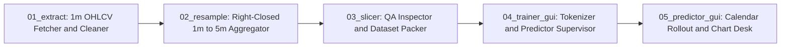

# KLine Kronos Suite (`v1.1.0`)

[](https://www.bestpractices.dev/projects/16679)
[](https://scorecard.dev/viewer/?uri=github.com/Ziqi/KLine-Kronos-Suite)
[](https://github.com/Ziqi/KLine-Kronos-Suite/attestations)
[](./LICENSE)

> **English** | **[简体中文 (`README.zh-CN.md`)](./README.zh-CN.md)**

**Deterministic intraday candlestick ("K-line" / OHLCV) cleaning, session-aligned `1m -> 5m` resampling, QA auditing, and fine-tuning/inference workstation for [Kronos](https://github.com/shiyu-coder/Kronos) (an open-source Tokenizer + Predictor financial candlestick foundation model), built with native China A-share (`SSE/SZSE: 09:30–11:30, 13:00–15:00`) session & lunch-break calendar alignment.**



---

## Quick Preview (No Clone Required)

Run the pure-stdlib `1m -> 5m` cleaning, right-closed resampling, QA audit, z-score round-trip, and `11:30 -> 13:05` China A-share lunch-break calendar stepper in a single command via **`uvx`** or **Homebrew**:

```bash
# Option A: Ephemeral run via uvx (requires uv >= 0.4 & Python 3.10+; zero local install)
uvx --from git+https://github.com/Ziqi/KLine-Kronos-Suite kline-kronos demo

# Option B: Install via official Homebrew tap (macOS & Linuxbrew)
brew install Ziqi/tap/kline-kronos-suite
kline-kronos demo
```

---

## Why KLine Kronos Suite?

Feeding high-frequency equity bars into financial foundation models such as **Kronos** often breaks silently due to messy market microstructure details (illustrated here on China A-share `09:30–11:30, 13:00–15:00` continuous auction sessions):
- **Call-auction & lunch-break artifacts** (`13:00:00` boundary ticks, `15:01–15:31` post-close ticks, or missing `15:00:00` closing bars);
- **Interval-label leakage** when resampling 1-minute bars to 5-minute bars without strict `closed='right', label='right'` alignment (`09:31..09:35 -> 09:35`);
- **Silent NaNs or non-monotonic timestamps** corrupting sliding-window Tokenizer/Predictor batches;
- **Calendar drift during multi-step rollouts** (naively adding `+5 minutes` across the `11:30–13:00` lunch break, overnight close, or weekends).

**KLine Kronos Suite** solves these end-to-end with **two complementary interfaces**:
1. **Zero-Dependency Deterministic Core & CLI (`kline_kronos/`)** — Pure Python 3.10+ standard library engine for headless `demo`, CSV `clean`, `1m -> 5m` `resample`, QA `audit`, SHA-256 dataset `manifest`, and z-score window scaling (`91.15%` `kline_kronos` core statement coverage, zero `pip install` needed).
2. **Five-Stage Desktop Workstation (`01_extract/` – `05_predictor_gui/`)** — Modular `ttkbootstrap` GUI apps + PyTorch process supervisors for interactive data operations, fine-tuning monitoring, and candlestick rollout inspection.



---

## Local CSV Pipeline Walkthrough

Run the full cleaning, `1m -> 5m` resampling, QA audit, and SHA-256 manifest pipeline on the bundled synthetic fixture (`examples/sample_1m_ohlcv.csv`):

```bash
git clone https://github.com/Ziqi/KLine-Kronos-Suite.git
cd KLine-Kronos-Suite

# 1. Clean raw 1-minute bars & synthesize zero-volume/zero-amount 15:00 session close bar if missing
python3 -m kline_kronos clean ./examples/sample_1m_ohlcv.csv --output /tmp/sample_1m_clean.csv

# 2. Resample 1m -> 5m (closed='right', label='right')
python3 -m kline_kronos resample /tmp/sample_1m_clean.csv --out-dir /tmp/out_5m

# 3. Audit OHLCVA (Open/High/Low/Close/Volume/Amount turnover) bounds & timestamp monotonicity
python3 -m kline_kronos audit /tmp/out_5m/sample_5m_clean.csv --min-rows 2

# 4. Emit deterministic SHA-256 dataset manifest
python3 -m kline_kronos manifest /tmp/out_5m --output /tmp/dataset_manifest.json --min-rows 2
```

---

## Five-Stage Workstation Architecture

| Module | Role | Entrypoints | Highlights |
| :--- | :--- | :--- | :--- |
| **[`kline_kronos/`](./kline_kronos/)** | **Deterministic Core & CLI** | `kline-kronos`<br/>`python3 -m kline_kronos` | Pure Python 3.10+ stdlib engine: `demo`, `clean`, `resample`, `audit`, `manifest`, z-score window scaling, and China A-share session calendar stepper. |
| **[`01_extract/`](./01_extract/)** | **1. 1m Collector & Cleaner** | `gui_fetch_kline.py`<br/>`miana_1m_clean_save.py`<br/>`resample_1m_to_5m.py` | Optional multi-threaded 1m HTTP quote fetcher (`MIANA_TOKEN`; not required when supplying your own CSVs), auction-noise filtering, and `15:00` bar synthesis. |
| **[`02_resample/`](./02_resample/)** | **2. `1m -> 5m` Aggregator** | `gui_resample_5m.py` | Multi-process right-closed 5-minute OHLCVA aggregation (`'5min'` syntax compatible with `pandas 2.x/3.x`; workstation pins `>=3.1.1`) with date-range filtering. |
| **[`03_slicer/`](./03_slicer/)** | **3. QA & Dataset Packer** | `gui_slicer.py` | Batch NaN / missing-column / length audit and Kronos `.pkl` dictionary export. |
| **[`04_trainer_gui/`](./04_trainer_gui/)** | **4. Fine-Tuning Console** | `gui_trainer.py` | Isolated `venv` process supervisor for Kronos Tokenizer & Predictor fine-tuning (`KRONOS_HOME`), live loss stream, and safe process termination. |
| **[`05_predictor_gui/`](./05_predictor_gui/)** | **5. Inference & Chart Desk** | `gui_predictor.py`<br/>`run_predictor_inference.py` | Cross-sectional z-score scaling (`clip[-5, 5]`), session-aware timestamp stepping, inverse scaling, and candlestick trajectory plotting. |

See [`docs/ROADMAP.md`](./docs/ROADMAP.md) for upcoming Parquet/SafeTensors backends and pluggable HKEX/US/crypto session calendars.

---

## Desktop Workstation Installation (Optional)

From a local clone (requires Python 3.10+ with system Tk, e.g. `brew install python-tk@3.12` on macOS or `sudo apt install python3-tk` on Debian/Ubuntu; Stages 4–5 also require `export KRONOS_HOME=/path/to/Kronos`):

```bash
git clone https://github.com/Ziqi/KLine-Kronos-Suite.git
cd KLine-Kronos-Suite
python3 -m venv .venv
source .venv/bin/activate
pip install -r requirements.txt
pip install -e .

# Launch any stage workstation:
python3 ./02_resample/gui_resample_5m.py
```

---

## Testing, Supply-Chain Security & Reproducible Builds

[](https://github.com/Ziqi/KLine-Kronos-Suite/actions/workflows/ci.yml)
[](https://github.com/Ziqi/KLine-Kronos-Suite/actions/workflows/codeql.yml)
[](./REUSE.toml)
[](https://www.python.org/)

- **Automated Coverage, Fuzzing & AST Security Gate:** `python3 ./tests/test_pipeline_core.py --min-coverage 85 && python3 ./tests/fuzz_kline_pipeline.py --iterations 2000` verifies end-to-end CLI/core behavior, trading-calendar edge cases, `>=85%` `kline_kronos` core CLI/pipeline statement coverage (`91.15%` actual; desktop GUI stages excluded), and AST invariants (zero `os.system`, zero bare `except:`).
- **Bit-for-Bit Reproducible Builds & SLSA Level 3 Provenance:** Run `python3 ./scripts/repro_archive.py --verify` (or `--verify-file kline-kronos-suite-v1.1.0.tar.gz`) to verify deterministic PAX source archives (`mtime=0`, `uid/gid=0`), attested via Sigstore **SLSA Build Level 3**, offline Ed25519 signatures ([`keys/release-signing-pub.pem`](./keys/release-signing-pub.pem)), and **SPDX-2.3** SBOMs under [`/attestations`](https://github.com/Ziqi/KLine-Kronos-Suite/attestations).
- **Security Policy & OSPS Baseline Level 3:** See [`SECURITY.md`](./SECURITY.md) for OpenSSF OSPS Baseline Level 3 compliance, private vulnerability reporting, and `.pkl` checkpoint trust-boundary guidelines.

## Acknowledgements & License

Built for workflow integration with the **Kronos** financial foundation model ecosystem ([`shiyu-coder/Kronos`](https://github.com/shiyu-coder/Kronos)). Released under the [MIT License](./LICENSE). Questions and ideas are welcome in [GitHub Discussions](https://github.com/Ziqi/KLine-Kronos-Suite/discussions).
