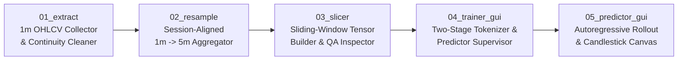

# KLine Kronos Suite

[](./LICENSE)
[](https://www.python.org/)
[](https://pytorch.org/)

**End-to-end intraday OHLCV acquisition, multi-timeframe resampling, tensor slicing, fine-tuning orchestration, and autoregressive inference workstation for financial time-series foundation models (Kronos).**

---

## Overview

Training and evaluating financial foundation models such as **Kronos** on high-frequency market data typically breaks down across disconnected scripts: raw 1-minute bar collection, session-aligned timeframe aggregation, NaN/continuity auditing, sliding-window tensor serialization, isolated GPU training supervision, and visual out-of-sample rollouts.

**KLine Kronos Suite** unifies all five stages into a cohesive, modular desktop & CLI pipeline (`ttkbootstrap` dark-gold workstation UI + standalone Python engines):



---

## Architecture & Five-Stage Modules

| Directory | Stage | Core Scripts | Key Capabilities |
| :--- | :--- | :--- | :--- |
| [`01_extract/`](./01_extract/) | **1. High-Frequency Acquisition** | `gui_fetch_kline.py`<br/>`miana_1m_clean_save.py`<br/>`resample_1m_to_5m.py` | Batch 1-minute OHLCV retrieval, timestamp deduplication, trading-session continuity checks, and clean CSV persistence. |
| [`02_resample/`](./02_resample/) | **2. Multi-Timeframe Aggregation** | `gui_resample_5m.py` | Deterministic 1-minute to 5-minute bar aggregation (`open/high/low/close/volume/amount`) preserving market session boundaries. |
| [`03_slicer/`](./03_slicer/) | **3. Tensor Slicing & QA** | `gui_slicer.py` | Converts 5-minute CSV series into normalized sliding-window PyTorch/Pickle tensor datasets with missing-value and outlier gates. |
| [`04_trainer_gui/`](./04_trainer_gui/) | **4. Two-Stage Fine-Tuning Console** | `gui_trainer.py` | Isolated `venv` process supervisor for Kronos Tokenizer & Predictor fine-tuning (Cosine Annealing LR, Early Stopping, live loss stream, safe process termination). |
| [`05_predictor_gui/`](./05_predictor_gui/) | **5. Autoregressive Inference Desk** | `gui_predictor.py`<br/>`run_predictor_inference.py` | Loads fine-tuned Tokenizer + Predictor checkpoints, runs cross-sectional feature alignment & autoregressive forecasting, and renders interactive candlestick trajectories. |

---

## Quickstart

```bash
git clone https://github.com/Ziqi/KLine-Kronos-Suite.git
cd KLine-Kronos-Suite
python3 -m venv .venv
source .venv/bin/activate
pip install -r requirements.txt
```

### Run Any Stage Independently

```bash
# Stage 1: 1-minute K-line collector GUI (or CLI cleaner)
python3 01_extract/gui_fetch_kline.py

# Stage 2: 1m -> 5m resampling studio (testable immediately with examples/sample_1m_ohlcv.csv)
python3 02_resample/gui_resample_5m.py

# Stage 3: Sliding-window tensor slicer & dataset QA
python3 03_slicer/gui_slicer.py

# Stage 4: Two-stage Kronos fine-tuning process supervisor
python3 04_trainer_gui/gui_trainer.py

# Stage 5: Autoregressive trajectory inference & candlestick viewer
python3 05_predictor_gui/gui_predictor.py
```

A lightweight synthetic dataset ([`examples/sample_1m_ohlcv.csv`](./examples/sample_1m_ohlcv.csv)) is bundled so you can verify resampling and tensor-slicing stages offline without configuring market data feeds.

---

## 中文架构说明（Chinese Overview）

**KLine Kronos Suite** 是一套面向 **Kronos** 等金融时序基础模型的端到端分钟级数据处理、微调监控与自回归推演桌面套件，将散乱的数据工程收敛为五个标准阶段：

1. **[`01_extract/`](./01_extract/)（1 分钟高频抓取与清洗基站）**：支持批量拉取 1 分钟级 OHLCV 行情、时间戳去重排序与断点连续性校验。
2. **[`02_resample/`](./02_resample/)（1m $\rightarrow$ 5m 降维重采样工作室）**：严格按交易时段边界将 1 分钟颗粒度数据聚合为标准 5 分钟级 K 线序列（可使用 [`examples/sample_1m_ohlcv.csv`](./examples/sample_1m_ohlcv.csv) 离线验证）。
3. **[`03_slicer/`](./03_slicer/)（深度学习张量切片与质检器）**：将多周期 CSV 转换为时序 Transformer / Kronos 可直接读取的滑动窗口张量包，内置异常值与缺失值质检。
4. **[`04_trainer_gui/`](./04_trainer_gui/)（两阶段微调流式控制台）**：在独立虚拟环境中托管 Tokenizer 与 Predictor 训练生命周期，实时流式捕获 Epoch / Loss 曲线，内置余弦退火（Cosine Annealing）与早停（Early Stopping）参数管理及安全中断保护。
5. **[`05_predictor_gui/`](./05_predictor_gui/)（自回归推演与原生 K 线画布终端）**：挂载本地微调权重，自动完成字段对齐与截面归一化，执行未来步长自回归生成并在原生 Canvas 中对比可视化。

---

## Acknowledgements & License

- Designed as a community data-engineering and workstation companion for financial time-series foundation models including [Kronos](https://github.com/shiyu-coder/Kronos).
- Released under the [MIT License](./LICENSE). For quantitative research and engineering validation only; nothing in this repository constitutes investment advice.
