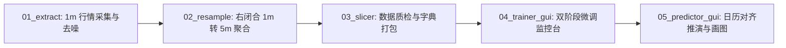

# KLine Kronos Suite（`v1.1.0` · 金融高频 K 线确定性清洗、右闭合重采样与 Kronos 推演套件）

[](https://www.bestpractices.dev/projects/16679)
[](https://scorecard.dev/viewer/?uri=github.com/Ziqi/KLine-Kronos-Suite)
[](https://github.com/Ziqi/KLine-Kronos-Suite/attestations)
[](./LICENSE)

> **[English (`README.md`)](./README.md)** | **简体中文**

围绕开源金融 K 线基础模型 **[Kronos](https://github.com/shiyu-coder/Kronos)**（Tokenizer + Predictor 双阶段时序模型）打造的端到端 **1 分钟高频行情去噪清洗 → 右闭合 5 分钟重采样 → 数据质检打包 → 双阶段微调监控 → A 股交易日历（`09:30–11:30, 13:00–15:00`）对齐推演画图** 模块化工程套件（同时提供 **零第三方依赖纯标准库 CLI** 与 **`ttkbootstrap` 五阶段桌面工作台**）。



---

## 免克隆快速体验（`uvx` / Homebrew）

无需克隆仓库或准备 CSV，直接通过 **`uvx`** 或官方 **Homebrew Tap** 单条命令运行内置示例流水线（涵盖 `1m -> 5m` 去噪补帧、右闭合重采样、`11:30 -> 13:05` 午休跨越步进与 `SHA-256` 清单）：

```bash
# 方式一：通过 uvx 零安装运行内置示例流水线演示（需 uv >= 0.4 与 Python 3.10+）
uvx --from git+https://github.com/Ziqi/KLine-Kronos-Suite kline-kronos demo

# 方式二：通过官方 Homebrew Tap 一键安装（macOS 与 Linuxbrew 通用）
brew install Ziqi/tap/kline-kronos-suite
kline-kronos demo
```

---

## 解决的核心工程痛点

1. **日内微结构噪音自动净化**：自动去重并剔除 `13:00:00` 午盘边界噪点与 `15:01–15:31` 盘后冗余帧，缺失 `15:00:00` 收盘帧时自动按最后成交价零成交量（`volume=0`）、零成交额（`amount=0`）补齐。
2. **严格的右闭合 `1m -> 5m` 时间窗对齐**：采用确定性 `closed='right', label='right'` 规则（`09:31..09:35` 聚合标记为 `09:35`），避免未来函数与跨段错位；重采样脚本兼容 `pandas 2.x / 3.x`（`'5min'` 语法；桌面工作台默认锁版本 `>=3.1.1`），同时提供纯标准库零依赖模式。
3. **张量入库前数据质检（QA Gate）与属性模糊测试**：自动拦截缺列、空值、`high < low` 价格倒挂与非单调时间戳，内置 2,000 轮属性模糊测试（`tests/fuzz_kline_pipeline.py`），并支持生成带 `SHA-256` 校验的 JSON 数据集清单。
4. **贴合 A 股交易日历的多步推演对齐**：推演步进器自动跨越 `11:30–13:00` 午休、隔夜休市与周末，执行截面 Z-Score 归一化（`clip[-5, 5]`）与逆变换还原真实价格刻度。



---

## 本地 CSV 数据流水线实操

克隆仓库后，直接使用 Python 3.10+ 即可在内置样本（`examples/sample_1m_ohlcv.csv`）上跑通完整数据链路：

```bash
git clone https://github.com/Ziqi/KLine-Kronos-Suite.git
cd KLine-Kronos-Suite

# 1. 清洗 1 分钟原始 K 线并补齐 15:00 零量零额收盘帧
python3 -m kline_kronos clean ./examples/sample_1m_ohlcv.csv --output /tmp/sample_1m_clean.csv

# 2. 按右闭合标准重采样为 5 分钟 K 线
python3 -m kline_kronos resample /tmp/sample_1m_clean.csv --out-dir /tmp/out_5m

# 3. 执行 OHLCVA（开高低收量额）上下界与时间戳单调性质检
python3 -m kline_kronos audit /tmp/out_5m/sample_5m_clean.csv --min-rows 2

# 4. 生成确定性 SHA-256 数据集资产清单
python3 -m kline_kronos manifest /tmp/out_5m --output /tmp/dataset_manifest.json --min-rows 2
```

---

## 五阶段模块架构

| 模块 | 定位 | 入口命令 / 脚本 | 核心能力 |
| :--- | :--- | :--- | :--- |
| **[`kline_kronos/`](./kline_kronos/)** | **确定性核心与 CLI** | `kline-kronos`<br/>`python3 -m kline_kronos` | 纯 Python 3.10+ 标准库引擎：`demo`、`clean`、`resample`、`audit`、`manifest`、Z-Score 窗口归一化与 A 股交易日历步进器。 |
| **[`01_extract/`](./01_extract/)** | **1. 1m 采集与清洗** | `gui_fetch_kline.py`<br/>`miana_1m_clean_save.py`<br/>`resample_1m_to_5m.py` | 可选多线程 1 分钟 HTTP 行情增量拉取（通过环境变量 `MIANA_TOKEN` 传入，自有 CSV 无需配置）、竞价噪点过滤与 `15:00` 补帧。 |
| **[`02_resample/`](./02_resample/)** | **2. `1m -> 5m` 聚合** | `gui_resample_5m.py` | 多进程右闭合 5 分钟 OHLCVA 批量聚合（支持日期区间过滤）。 |
| **[`03_slicer/`](./03_slicer/)** | **3. 质检与打包** | `gui_slicer.py` | 批量空值 / 缺列 / 长度体检与 Kronos `.pkl` 训练字典导出。 |
| **[`04_trainer_gui/`](./04_trainer_gui/)** | **4. 双阶段微调台** | `gui_trainer.py` | 隔离虚拟环境下的 Kronos `Tokenizer` 与 `Predictor` 训练进程监管、实时 Loss 流与安全启停（读取 `KRONOS_HOME`）。 |
| **[`05_predictor_gui/`](./05_predictor_gui/)** | **5. 推演与 K 线台** | `gui_predictor.py`<br/>`run_predictor_inference.py` | 截面 Z-Score 归一化（`clip[-5, 5]`）、交易时段步进、逆变换还原与 K 线轨迹绘制。 |

后续 Parquet/SafeTensors 零拷贝后端与港美股/加密多市场交易日历规划请参阅 [`docs/ROADMAP.md`](./docs/ROADMAP.md)。

---

## 桌面工作台安装（可选）

如需运行 `ttkbootstrap` 桌面 GUI 与 PyTorch 推演脚本（需系统具备 Tk 图形支持，例如 macOS 执行 `brew install python-tk@3.12`，Debian/Ubuntu 执行 `sudo apt install python3-tk`；第 4–5 阶段需配置 `export KRONOS_HOME=/path/to/Kronos`）：

```bash
git clone https://github.com/Ziqi/KLine-Kronos-Suite.git
cd KLine-Kronos-Suite
python3 -m venv .venv
source .venv/bin/activate
pip install -r requirements.txt
pip install -e .

# 启动任意阶段桌面工作台：
python3 ./02_resample/gui_resample_5m.py
```

---

## 供应链安全、可重现构建与开源协议

[](https://github.com/Ziqi/KLine-Kronos-Suite/actions/workflows/ci.yml)
[](https://github.com/Ziqi/KLine-Kronos-Suite/actions/workflows/codeql.yml)
[](./REUSE.toml)
[](https://www.python.org/)

- **自动化质量门禁**：执行 `python3 ./tests/test_pipeline_core.py --min-coverage 85 && python3 ./tests/fuzz_kline_pipeline.py --iterations 2000` 验证单元测试、2,000 轮模糊测试、AST 安全扫描以及 `kline_kronos` 核心算法与 CLI 语句覆盖率（实测 `91.15%`，不含桌面 GUI 模块）。
- **逐比特可重现归档与 SLSA Level 3 溯源**：执行 `python3 ./scripts/repro_archive.py --verify`（或 `--verify-file kline-kronos-suite-v1.1.0.tar.gz`）验证确定性 PAX 归档（`mtime=0, uid/gid=0`），每次发布均附带 Sigstore **SLSA Build Level 3** 证明、离线 Ed25519 签名（公钥见 [`keys/release-signing-pub.pem`](./keys/release-signing-pub.pem)）与 **SPDX-2.3** SBOM（见 [`/attestations`](https://github.com/Ziqi/KLine-Kronos-Suite/attestations) 及 [`SECURITY.md`](./SECURITY.md)）。
- 本项目基于 [MIT License](./LICENSE) 开源，欢迎在 [GitHub Discussions](https://github.com/Ziqi/KLine-Kronos-Suite/discussions) 交流量化数据工程与 Kronos 微调实践。
